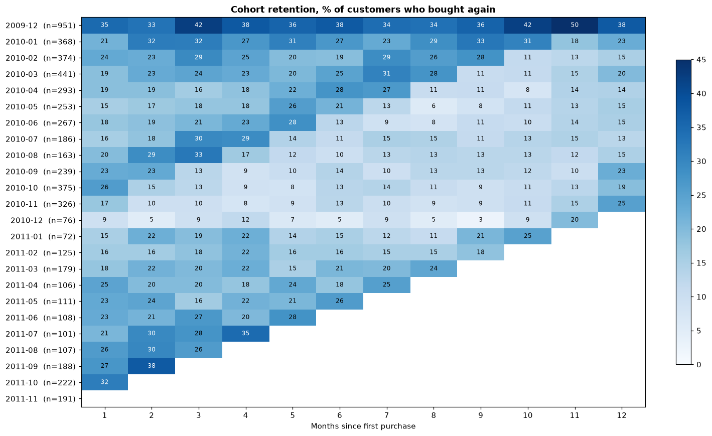
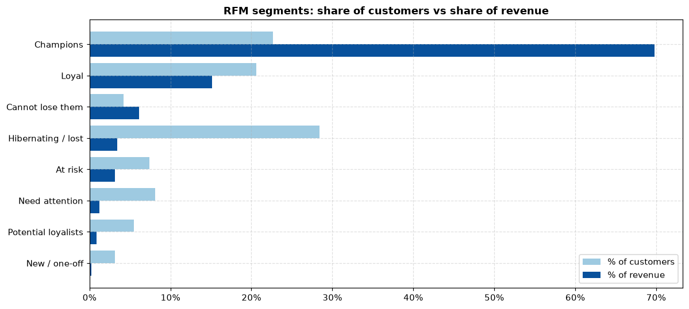
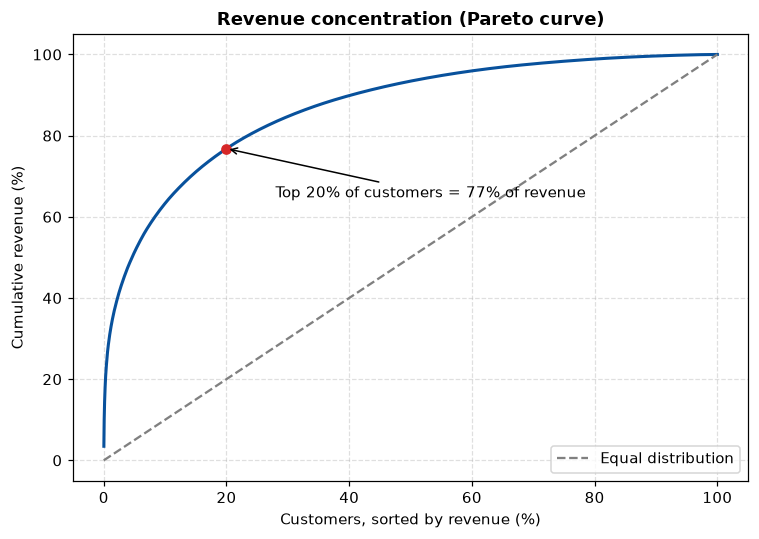
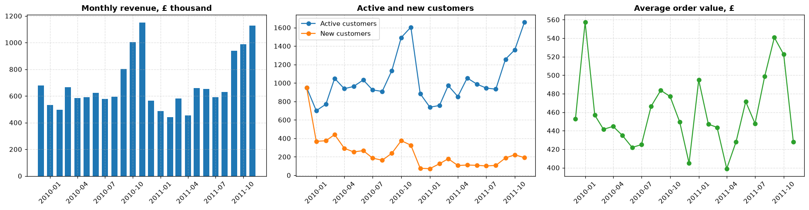

# E-commerce Customer Analytics

Customer analytics on **1.07 million real transactions** of a UK online gift retailer (2009–2011): data cleaning, monthly KPIs, cohort retention, RFM segmentation, revenue concentration and returns. All analysis is in SQL on DuckDB.



## Key findings

| | |
|---|---|
| Clean data | 775,540 sales lines · 5,850 customers · 36,492 orders · £16.75M revenue |
| Seasonality | September–November = **40%** of yearly revenue; Jan–Nov 2011 vs 2010: **−0.9%** |
| Retention | ~**21%** of a cohort buy again next month, ~**18%** still buy in month 12 |
| Concentration | Top 20% of customers = **77%** of revenue, top 1% = **31%** |
| RFM | *Champions*: 23% of customers, **70%** of revenue |
| Reactivation target | 224 *Cannot lose them* customers, **£0.98M** spent, inactive ~340 days |
| Returns | **2.4%** of sales after cleaning (4.2% before removing order-entry errors) |

**What this means for the business**
- Growth stalled in 2011, and the year depends on the autumn peak.
- The biggest drop-off happens before the second purchase. Customers who come back usually stay, so the second order is the key moment.
- A small group of high-value customers who stopped buying is worth a targeted win-back campaign.
- The *cherry lights* product range has 30–37% of sales value returned and needs a quality check.

## Data cleaning

The raw data has several problems that would distort the results:

| Problem | Rows | Fix |
|---|---|---|
| No customer ID | 243,007 | Excluded from customer-level analysis |
| Exact duplicates (the two Excel sheets overlap) | 34,335 | Removed |
| Non-product codes: postage, Amazon fees, bank charges, adjustments, test items, gift vouchers | ~6,000 | Removed |
| Order-entry errors: orders cancelled by the same customer within an hour, with the same product, quantity and price (largest: 80,995 units, £168k) | 1,039 lines, £318k | Removed from both sales and returns |
| Cancellations (`C` invoices) | 16,600 after cleaning | Analysed separately as returns |

## Analysis

| Section | SQL techniques |
|---|---|
| Monthly revenue, orders, active and new customers, AOV | `DATE_TRUNC`, `FILTER`, CTEs |
| Cohort retention heatmap | `MIN() OVER (PARTITION BY)`, `DATE_DIFF` |
| RFM segmentation | `NTILE(5)` window functions, `CASE` rules |
| Revenue concentration (Pareto) | `ROW_NUMBER()`, window totals |
| Returns by product | Joins, rates against sales |
| Top countries | `QUALIFY`, `SUM(SUM()) OVER ()` |

<p>
  
  
</p>



## Tech stack

Python · DuckDB · SQL · pandas · NumPy · Matplotlib · Jupyter

## How to run

```bash
git clone https://github.com/Siren-heart/ecommerce-customer-analytics.git
cd ecommerce-customer-analytics
pip install -r requirements.txt
jupyter notebook main.ipynb
```

On the first run the notebook downloads the dataset (45 MB) from UCI and converts it to Parquet in `data/`. This takes about a minute. Later runs take seconds.

## Data source

Chen, D. (2012). *Online Retail II* [Dataset]. UCI Machine Learning Repository. https://doi.org/10.24432/C5CG6D. Licensed under CC BY 4.0.

## Limitations

- Customer-level metrics exclude rows without a customer ID, about 23% of raw rows.
- The December 2009 cohort includes customers who were already buying before the data starts.
- Many customers are wholesalers, so order values are much higher than in typical retail.
- RFM segment rules are a common convention, not fitted to this data.
